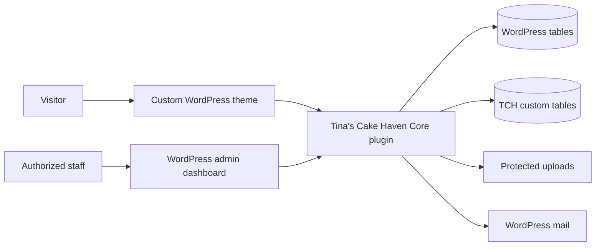

# Tina's Cake Haven

**Live website:** [https://tinascakehaven.noscamcoin.org](https://tinascakehaven.noscamcoin.org)

Tina's Cake Haven is a WordPress-based cake and bakery website for a business in Kibimba, Fort Portal, Uganda. It presents the bakery catalogue, accepts standard and customized cake orders, supports customer accounts and order tracking, and provides a staff dashboard for order and Mobile Money payment administration.

## Business background

The business serves customers who need birthday cakes, cupcakes, cookies and custom-designed cakes. The website was developed as the BIT 2103 Internet Technologies & Advanced Web Development practical project at Mountains of the Moon University. The owner identified in the source configuration is **Aluka Christin Hellen**.

## Project objectives

- Present the bakery and its products professionally.
- Allow customers to place standard and customized cake orders online.
- Calculate prices on the server from trusted product configuration.
- Accept full payments or 50% deposits through a manual Mobile Money process.
- Give customers account history and guest order tracking.
- Give authorized staff tools to manage orders, payments and catalogue options.
- Provide responsive presentation, content management and search-engine structured data.

## Technologies used

| Area | Implementation |
|---|---|
| CMS | WordPress |
| Programming | PHP |
| Database | MySQL/MariaDB |
| Front end | HTML, CSS, JavaScript |
| Theme system | WordPress block theme templates and theme.json |
| Page presentation | Elementor-compatible theme support |
| Security | Custom plugin hardening, Wordfence, Apache/LiteSpeed rules |
| SEO | Custom schema and Yoast SEO support |
| Caching | WP Super Cache |
| Backup | UpdraftPlus |
| Hosting | LiteSpeed server observed on the live domain; exact provider and control-panel details require confirmation |

The local project contains WordPress core 7.1.5 according to `wp-includes/version.php`. The custom plugin requires WordPress 6.5 or newer and PHP 8.0 or newer.

## Main website features

- Responsive homepage with a managed hero slider.
- Cake, cupcake and cookie catalogue.
- Categories and individual product pages.
- Standard order form with collection or delivery details.
- Custom birthday-cake request form with reference-photo upload.
- Server-side size, flavour and quantity pricing.
- Customer registration, login, profile and password management.
- Customer order history.
- Guest order tracking using an order reference and phone number.
- Mobile Money payment submission and manual staff verification.
- Staff business dashboard, order status management and payment queue.
- Contact form and WhatsApp integration.
- Homepage, product and business JSON-LD structured data.
- Private-page cache disabling and upload access protection.

## Architecture

WordPress is the application shell. A custom block theme provides presentation and templates, while the **Tina's Cake Haven Core** plugin owns business records, order and payment logic, custom tables, shortcodes, account features and the staff dashboard.



## Custom theme

`wp-content/themes/tinas-cake-haven/` is a WordPress block theme. It contains templates, template parts, patterns, typography, brand assets and the homepage hero-slider integration. Business logic is deliberately kept in the core plugin rather than the theme.

## Custom plugin

`wp-content/plugins/tinas-cake-haven-core/` provides:

- Cake Products and Product categories.
- Cake sizes and flavours.
- Standard and custom orders.
- Order status and payment history.
- Manual Mobile Money payment verification.
- Customer accounts and order history.
- Guest order tracking.
- Contact messages.
- Business settings, dashboard and notifications.
- Security, SEO and private-upload support.

The plugin is theme-independent.

## Database overview

The project uses standard WordPress tables plus custom tables prefixed with `<wpdb_prefix>tch_`, for example `wp_tch_orders` in a default installation:

- `cake_sizes`
- `flavours`
- `orders`
- `order_items`
- `custom_requests`
- `payments`
- `payment_log`
- `status_history`
- `messages`

Full fields and relationships are documented in [docs/database-documentation.md](docs/database-documentation.md).

## Installation prerequisites

- Windows 10 or compatible Windows
- WAMP with Apache and MySQL/MariaDB
- PHP 8.0 or newer
- WordPress 6.5 or newer
- Access to a MySQL/MariaDB administrator account
- A database backup, if restoring an existing installation

## Local installation summary

1. Start WAMP and verify Apache/MySQL are running.
2. Copy the project under `C:\wamp64\www\tinas-cake-haven`.
3. Create a local database in phpMyAdmin.
4. Import an authorized database backup if available. No backup is present in the inspected project.
5. Create or update `wp-config.php` using placeholder database credentials. This project requires a protected WordPress configuration and must not expose real secrets.
6. Open `http://localhost/tinas-cake-haven/` or the local host/port configured for WAMP.

Use placeholders such as `DB_NAME`, `DB_USER`, `DB_PASSWORD` and `DB_HOST=localhost` rather than real credentials.

The complete process is in [docs/installation-guide.md](docs/installation-guide.md).

## WordPress administration

Open `/wp-admin/` on the relevant local or live site. Credentials must be obtained from the site owner or configured administrator and must not be stored in this repository. Customer accounts are redirected away from the WordPress administration area.

## Product and order management

Authorized staff can manage:

- Cake Products, descriptions and images under **Cake Products**.
- Cake sizes, flavours and prices under **Cake Orders → Sizes & flavours**.
- Orders under **Cake Orders → All orders**.
- Order status and internal/admin notes.
- Mobile Money submissions under **Cake Orders → Verify payments**.
- Customer messages and business settings.

## Security measures

Verified source and live-host evidence includes:

- HTTPS redirects and HSTS observed on the live site.
- Security headers: `X-Content-Type-Options`, `X-Frame-Options`, `Referrer-Policy`, `Permissions-Policy` and HSTS.
- XML-RPC disabled.
- Generic login errors and an author-scan redirect.
- REST public user endpoint removal for unauthorized visitors.
- Staff-password validation and login throttling or Wordfence integration.
- CSRF-style WordPress nonces on forms and admin actions.
- Server-side input sanitization and prepared SQL in custom modules.
- Private order/account pages marked not to cache.
- Protected private upload directories.
- Wordfence, UpdraftPlus and WP Super Cache plugin source present.

Wordfence scan status, 2FA status and file ownership/permissions require confirmation through the hosting dashboard. Sensitive configuration values and real backup contents must not be published.

## SEO and performance

- Yoast SEO support is present.
- Bakery and product JSON-LD is generated by the custom plugin.
- Private pages are excluded from public sitemap/user sitemap output.
- Images are cached for one year and CSS/JavaScript for one month through Apache rules.
- Text, CSS, JavaScript and SVG compression is enabled in `.htaccess`.
- Above-the-fold fonts are preloaded.
- Private pages use no-cache headers and WP Super Cache opt-out logic.

## Deployment

The live domain is [https://tinascakehaven.noscamcoin.org](https://tinascakehaven.noscamcoin.org). The live server observed by the request headers uses LiteSpeed and PHP 8.2.36. Use DNS, document-root, SSL and database credentials supplied by the authorized hosting provider. The deployment process must preserve WordPress core, the custom theme, the custom plugin, the database and `wp-content/uploads`.

## Local and live URL reference audit

The following source references were found and classified:

| Reference | Location | Classification |
|---|---|---|
| `localhost` and `127.0.0.1` | `.htaccess`, `wp-config.php` and WordPress core HTTP code | Development-only/local routing or HTTP local-host checks |
| `localhost:8080` | `wp-config.php` fallback | Development-only local WordPress URL configuration |
| `/tinas-cake-haven` | `wp-config.php` and `.htaccess` | Local project path/configuration and Apache rewrite context |
| `tinas-cake-haven` text | Theme/plugin slugs, metadata and setup labels | Application namespace and WordPress text domain, not a live-domain URL |
| `tinascakehaven.noscamcoin.org` | Live site and newly created deployment documentation | Public live-domain URL |

No global URL replacement was performed. WordPress database options and serialized values were not changed.

## `.gitignore` behavior

The `.gitignore` file protects Git submissions by excluding credentials, environment files, database/ZIP backups, logs, caches, private uploads and IDE state. It does not delete or move files from the original project directory, and it does not remove them from a manually prepared ZIP or copied folder. Custom theme and core-plugin source are intentionally retained; WordPress uploads are excluded because they may contain private or unnecessary media.

## Directory structure

```text
tinas-cake-haven/
├── README.md
├── .gitignore
├── docs/
├── wp-admin/
├── wp-content/
│   ├── plugins/
│   │   └── tinas-cake-haven-core/
│   ├── themes/
│   │   └── tinas-cake-haven/
│   └── uploads/
├── wp-includes/
├── wp-config.php
└── .htaccess
```

## Testing overview

The current source provides unit-like implementation guardrails but no complete automated test suite was found. Live source inspection and live HTTP verification are documented in [docs/testing-report.md](docs/testing-report.md). Orders and payments were not submitted during documentation preparation.

## Known limitations

- No automated payment-provider API integration exists.
- Payment verification is manual and depends on staff checking the real Mobile Money account.
- No database backup or SQL dump was found in the project directory.
- Wordfence scan/2FA status is not verifiable from source alone.
- Hosting-provider account details and exact deployment credentials are unavailable.
- Email delivery configuration and third-party services require operational confirmation.
- Private/local URL behavior can differ between WAMP and the live host.

## Documentation

- [Project overview](docs/project-overview.md)
- [System architecture](docs/system-architecture.md)
- [Database documentation](docs/database-documentation.md)
- [Local installation guide](docs/installation-guide.md)
- [Business owner user guide](docs/user-guide.md)
- [Order management workflow](docs/order-management-workflow.md)
- [Security report](docs/security-report.md)
- [Testing report](docs/testing-report.md)
- [Deployment guide](docs/deployment-guide.md)
- [Maintenance guide](docs/maintenance-guide.md)

## Academic information

- **Course:** BIT 2103 Internet Technologies & Advanced Web Development practical examination
- **Institution:** Mountains of the Moon University
- **Project:** Tina's Cake Haven

