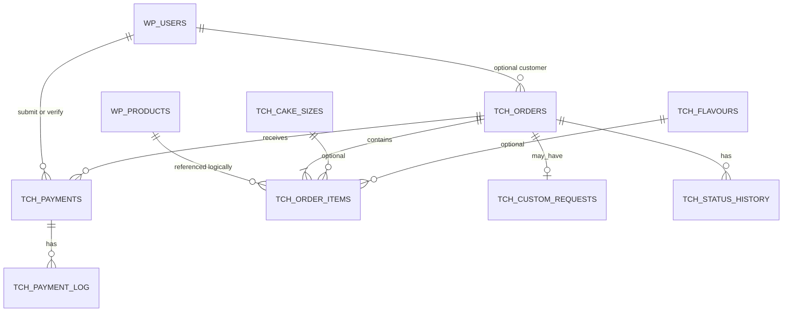

# Database Documentation

## Scope and prefix

The WordPress prefix is a deployment-specific value. Custom table examples use `<wpdb_prefix>tch_`, for example `<wpdb_prefix>tch_orders`. The plugin allows only a fixed list of table short names and computes names through `tch_table()`.

No real customer records or database credentials are included here.

## Custom tables

### `<wpdb_prefix>tch_cake_sizes`

Stores selectable cake sizes.

| Field | Purpose |
|---|---|
| `id` | Primary key |
| `name` | Size name |
| `weight_label` | Display weight |
| `price` | Whole-shilling size price |
| `sort_order` | Display order |
| `is_active` | Whether the size is selectable |
| `updated_at` | Last update |

### `<wpdb_prefix>tch_flavours`

Stores selectable cake flavours.

| Field | Purpose |
|---|---|
| `id` | Primary key |
| `name` | Unique flavour name |
| `sort_order` | Display order |
| `is_active` | Whether the flavour is selectable |

### `<wpdb_prefix>tch_orders`

Stores the main order record.

Important fields: `id`, `order_ref`, `submission_key`, `user_id`, `order_type`, `customer_name`, `customer_phone`, `customer_phone_norm`, `customer_email`, `fulfilment`, `delivery_address`, `needed_by`, `total_amount`, `payment_plan`, `amount_expected`, `amount_paid`, `order_status`, `payment_status`, timestamps and notes.

- Primary key: `id`
- Unique keys: `order_ref`, `submission_key`
- Logical relationship: `user_id` points to the corresponding standard WordPress user ID when the customer is logged in; a guest order may have a null user ID.

### `<wpdb_prefix>tch_order_items`

Stores each line in an order.

Important fields include `order_id`, `product_id`, `product_name`, `size_id`, `size_label`, `flavour_id`, `flavour_label`, quantity and line totals.

- Primary key: `id`
- Foreign key: `order_id -> tch_orders.id`, cascading on delete
- Foreign keys: `size_id -> tch_cake_sizes.id` and `flavour_id -> tch_flavours.id`, with `SET NULL`
- `product_id` logically references a WordPress `tch_product` post ID; no SQL foreign key is declared in the custom schema.

### `<wpdb_prefix>tch_custom_requests`

Stores customized-cake details.

Important fields: `order_id`, design description, inscription, event date, reference file and special instructions.

- Primary key: `id`
- Unique key: `order_id`
- Foreign key: `order_id -> tch_orders.id`, cascading on delete

### `<wpdb_prefix>tch_payments`

Stores customer and staff payment records.

Important fields include `order_id`, payment type, method, amount, transaction reference, payer phone, evidence file, status, source, submitter/verifier IDs, timestamps and admin note.

- Primary key: `id`
- Foreign key: `order_id -> tch_orders.id`, cascading on delete
- `submitted_by` and `verified_by` logically reference WordPress user IDs.

### `<wpdb_prefix>tch_payment_log`

Stores payment-state audit history.

Important fields: `payment_id`, action, old/new status, actor ID, note and timestamp.

- Primary key: `id`
- Foreign key: `payment_id -> tch_payments.id`, cascading on delete
- `actor_id` logically references a WordPress user ID.

### `<wpdb_prefix>tch_status_history`

Stores order-status changes.

Important fields: `order_id`, old/new status, changed-by user ID, note and timestamp.

- Primary key: `id`
- Foreign key: `order_id -> tch_orders.id`, cascading on delete

### `<wpdb_prefix>tch_messages`

Stores contact-form messages.

Important fields: name, phone, email, subject, message, read status and timestamp.

- Primary key: `id`

## Standard WordPress tables and data

The application also uses standard WordPress tables for:

- Users and password hashes.
- Posts, including `tch_product`.
- Taxonomies, including `tch_product_cat`.
- Post metadata, including product price and ordering configuration.
- Options, including business settings, page IDs and plugin database version.

## Relationship summary

The diagram distinguishes logical WordPress relationships from SQL foreign keys. Only relationships explicitly present in source or schema are shown.

