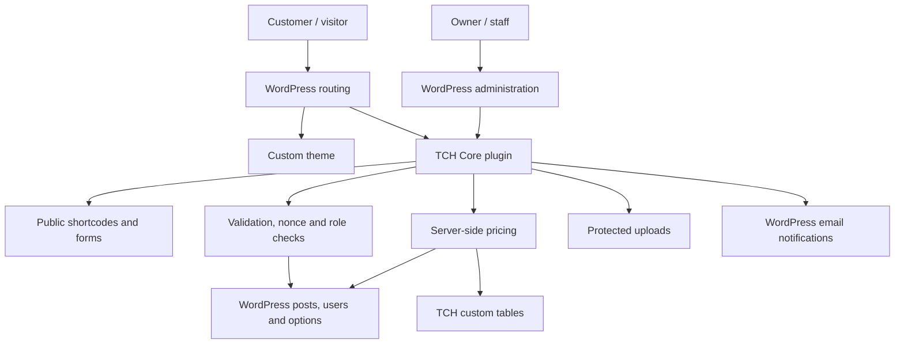

# System Architecture

## WordPress architecture

The system uses WordPress as the CMS and application framework. Apache/LiteSpeed routes pretty permalinks to WordPress, WordPress resolves pages and shortcodes, and PHP renders the custom block theme and plugin output. WordPress options and standard user/post tables coexist with custom plugin tables.

## PHP application logic

The custom plugin is loaded from `wp-content/plugins/tinas-cake-haven-core/tinas-cake-haven-core.php`. It loads modules for installation, settings, catalogue, uploads, orders, payments, notifications, accounts, frontend forms, security, mail, SEO and administration.

Important responsibilities include:

- Server-side price calculation.
- Order validation and database transactions.
- Payment claim submission and manual verification.
- WordPress user roles and custom capabilities.
- Shortcodes and public form handling.
- Staff administration screens.
- Security headers and public endpoint restrictions.

## Custom theme

`wp-content/themes/tinas-cake-haven/` is presentation-focused. It includes block templates and parts, patterns, CSS, theme metadata, navigation, brand assets and the homepage hero-slider renderer. It does not contain the order and payment database implementation.

## Custom plugin

The plugin owns:

- `tch_product` and `tch_product_cat`.
- Cake sizes and flavour records.
- Order, item, custom-request, payment and message tables.
- Manual payment verification and status history.
- Customer account and order-history shortcodes.
- Staff dashboard capabilities.
- Business settings and notifications.

## Interaction diagram

## Component interaction

1. WordPress resolves a public page or shortcode.
2. The custom theme supplies the page layout and brand assets.
3. The core plugin obtains the catalogue and settings from WordPress/custom tables.
4. Public form submissions pass nonce, honeypot and rate-limit checks.
5. Order and payment values are sanitized and validated.
6. Important inserts and status changes use prepared SQL and database transactions.
7. The owner receives an in-application/email notification where configured.

## Order-processing workflow

1. A customer selects a product or custom cake.
2. PHP validates the required fields and server-calculates the total.
3. The order and line items are written in a transaction.
4. A unique order reference and status history are created.
5. The customer receives a guest token or logs in for order history.
6. A customer submits payment details and optional evidence.
7. The payment becomes `pending_verification`; the order moves to `awaiting_verification`.
8. Authorized staff compare the claim with the real Mobile Money account.
9. Staff verify or reject the payment.
10. Verified amounts update the order balance and payment status.
11. Staff update the order through processing to completed or cancelled.

## Customer interaction workflow

- Public catalogue browsing does not require login.
- Customers can register and use My Account.
- Standard/custom order forms can be used by logged-in or guest customers.
- Logged-in customers can view their order history.
- Guests track an order with the order reference and normalized phone number.
- Payment evidence is stored privately and not exposed through public media URLs.

